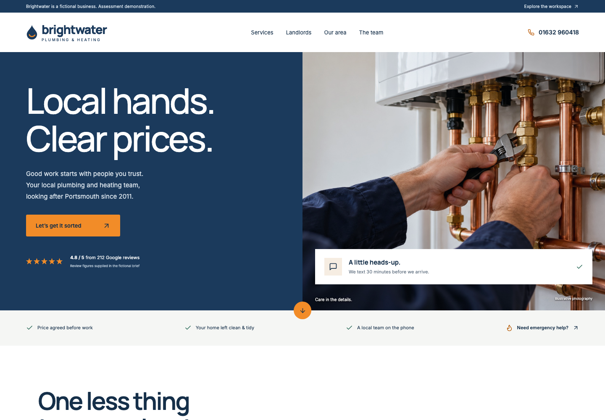

# Brightwater Plumbing & Heating

Meraki technical assessment: a multi-page public website and authenticated operations workspace, extended with simulated automations and an AI voice-call studio. **Browser calls and business actions remain simulated. A real inbound Plivo telephone pilot is now implemented; bookings, general customer-operation messages and dispatches are still simulated. Explicitly selected support-ticket emails now use Gmail SMTP, with dedicated-folder IMAP intake.** AI and voice providers process test conversations when configured; use fictional data only.

[GitHub repository](https://github.com/Ree-saved2307/brightwater-meraki-assessment)

**Readiness: functional prototype / supervised pilot. Not industry-grade or certified.** See the [production-readiness assessment](docs/production-readiness.md) for evidence and release gates.

## Live application

- [Public website](https://brightwater-app-production.up.railway.app)
- [Staff workspace](https://brightwater-app-production.up.railway.app/workspace)
- Public pages: `/services`, `/pricing`, `/coverage`, `/about`, `/contact`, `/landlords`.
- One web deployment serves both website and workspace. Worker, scheduler, PostgreSQL and Redis are separate Railway services.



## Start locally

Use Node.js 24 and npm. Clone this repository, then:

```sh
npm ci
cp .env.example .env.local
npm run dev
```

For a local fictional demonstration set `DEMO_MODE=true` in `.env.local`, `DATA_DIR=./data`, and a random `SESSION_SECRET` of at least 32 characters. Open http://127.0.0.1:3000. Never enable demo mode on a public deployment. Local storage defaults to SQLite; set `DATABASE_URL` for PostgreSQL. No AI key is needed for scripted mode. Server-only `DEEPSEEK_API_KEY` and `ELEVENLABS_API_KEY` enable real provider processing inside simulated calls. Do not commit keys.

```sh
npm test
npm run typecheck
npm run build
npm start
```

`npm run worker` runs the local automation loop using `.env.local`. Production starts with `node scripts/start-hosted.mjs`; see the deployment guide for required variables and separate service roles.

## Documentation

- [Documentation index and suggested reading order](docs/README.md)
- [Production readiness, test evidence and remaining work](docs/production-readiness.md)
- [Telephone operations and incident runbook](docs/telephone-runbook.md)

- [Plivo inbound pilot and test procedure](docs/plivo-pilot.md)

- [Operation, architecture, deployment and troubleshooting](docs/handbook.md)
- [Assessment checklist and remaining evidence](docs/assessment-checklist.md)
- [Telephony flow, build sheet, questions, client email and support ticket](docs/telephony-and-support.md)
- [Development summary and AI assistance disclosure](docs/development-summary.md)

## Telephone streaming

The Plivo inbound pilot now supports an ElevenLabs audio bridge with caller interruption. See [streaming setup and limits](docs/plivo-pilot.md#streaming-upgrade). The Call simulator includes a live telephone map viewer. Carrier/handset quality still requires real-call verification.

## What works

Validated enquiries feed the staff workspace. Individual accounts have admin, dispatcher, engineer and viewer permissions. Staff manage enquiries, assignments, tasks, priorities, rota, customer history, reports and audited settings. New active engineers are available in assignment and rota selectors; gas qualifications require administrator verification.

The call studio combines DeepSeek tool use with optional ElevenLabs speech/transcription. Its 27-stage map and 13 scenario presets show observed context and tool activity, not hidden reasoning. Actions require operator approval and create internal simulated work. The map supports pan, bounded zoom, follow, fit and stage selection.


## Technologies and assistance

Next.js 16, React 19, TypeScript, Node.js 24, PostgreSQL, local SQLite, Redis/BullMQ, Docker and Railway; bcrypt password hashing; DeepSeek reasoning and ElevenLabs voice; CSS, Lucide icons, Manrope and Inter fonts. Tests use Node's test runner and tsx.

ChatGPT/Codex assisted with planning, implementation, debugging, tests and documentation. Recorded skills/workflows include Taste Skill, Impeccable and gstack browser verification; AI image generation supplied concepts and labelled illustrative photography. AI assistance was substantial, not merely proofreading. Generated output required factual corrections and browser testing. See the development summary for limitations and learning.

## Submission status

Core website and Task 2/3 drafts are present. **Do not interpret this repository as proof of every assessment checkbox.** Physical-mobile testing, original Brand Pack assets, free-hosting compliance, formal submission delivery and final submission delivery remain unverified/outstanding. The [checklist](docs/assessment-checklist.md) distinguishes implementation from delivery evidence.

This is an assessment simulation, not a certified production enterprise service. MFA/SSO, external SMS delivery, cross-provider disaster recovery and universal conversational reliability are not claimed. Real inbound telephony is a pilot; support-ticket email is a separate, explicitly selected live Gmail integration.

## Support helpdesk

The workspace **Support** area now includes assigned tickets, priorities, public/internal conversations, elapsed-hour response/resolution targets, overdue Tasks, private customer portal links, Gmail outbox tracking and isolated-folder email intake. See the [helpdesk guide](docs/helpdesk.md) for setup, operation, permissions and limitations.
