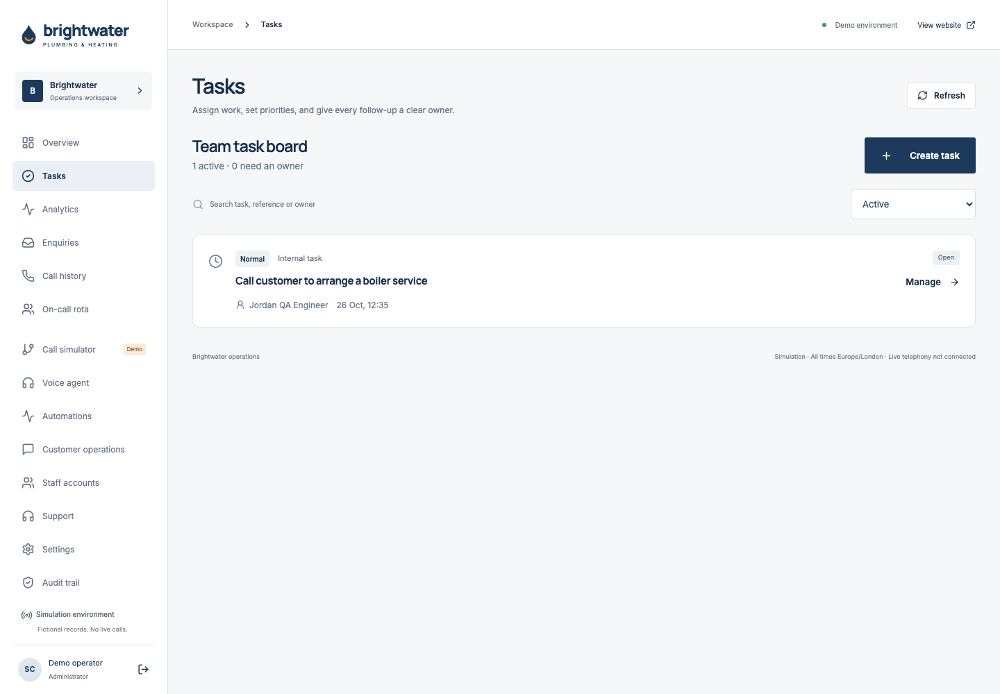
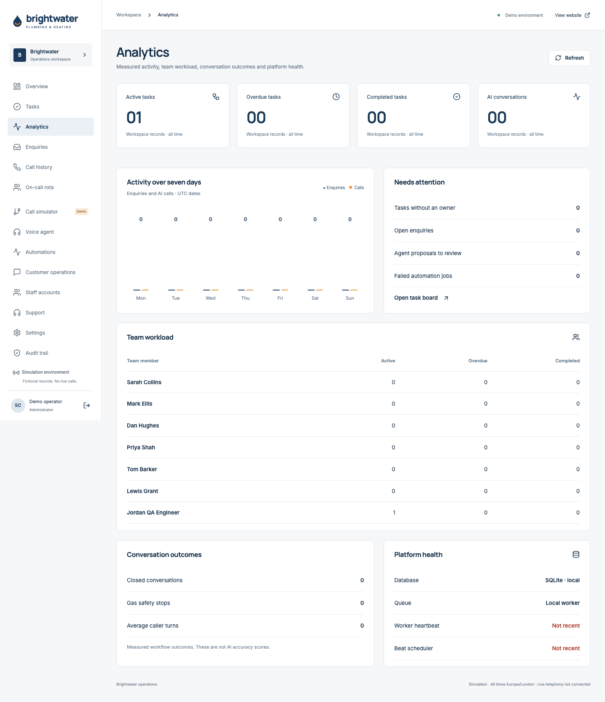
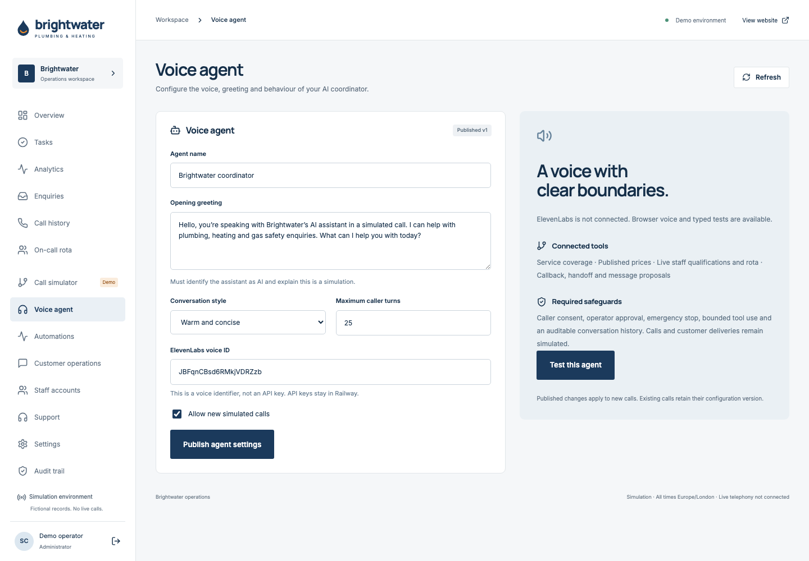
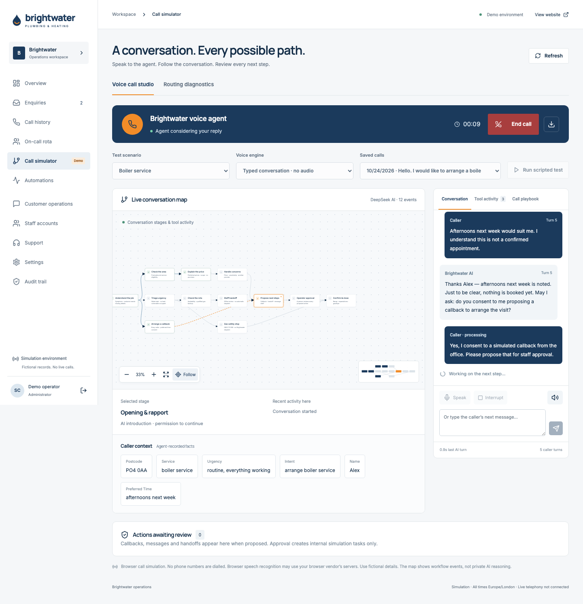
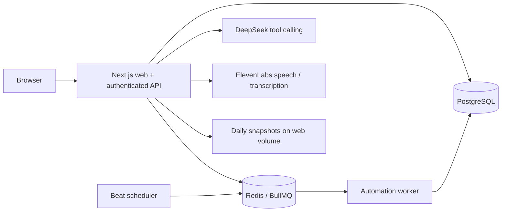

# Operations and deployment handbook

## Use the software

1. Browse the public service/pricing pages; use Coverage to check a postcode and service. PO10 is excluded; Chichester and Southampton have restricted eligibility. Contact collects name, phone, email, postcode, job type and message, validates them and returns a reference. Enquiries are stored for office processing; customer acknowledgment delivery is simulated.
2. Sign into `/workspace` with an individual staff account. Initial administrator creation uses the private server-side SETUP_TOKEN and locks after the first account. Administrators create subsequent users. Credentials are not published here.
3. In Enquiries, search/filter, assign an owner, update status and add internal notes. In Tasks, assign work, priority and due date; engineers update only their own tasks. Version checks reject stale edits.
4. Publish the on-call rota with appropriately qualified backup. Review handover acknowledgments and gaps. Apprentice Lewis is never eligible for on-call work.
5. Review Automations for due work, failures and heartbeat status; Customer operations for customer history and simulated communication records; Analytics for workload, overdue tasks and recorded outcomes.

## Voice calls

Voice agent settings control name, AI-disclosing greeting, voice ID, style, turn limit and enabled state. Only administrators publish changes; existing calls keep their profile snapshot. Call simulator offers the conversational studio and separate routing diagnostics.

Select a scenario and voice engine, start a call, click Speak, allow microphone permission, and speak. ElevenLabs records a turn, transcribes it, then the AI checks tools and replies with speech. An approximately 2.8-second pause after speech ends a turn, with a 30-second maximum recording. A caller needing longer can take another turn or type. Interrupt stops playback; this is turn-based audio, not full-duplex telephony. Browser voice is an alternative with browser-specific recognition restrictions. Scripted tests are optional and may use configured providers; do not run them assuming they are free.

Context branches cover clarification, changed facts, complaints, accounts, existing-job changes, portfolios, access needs, consent and escalation. Verified coverage results create explicit restriction/outside-area branches. Gas hazards stop the ordinary workflow. AI instructions favour short replies, patience, clarification, calm boundaries for abuse and human review when uncertain. These are behavioural controls, not evidence of universal reliability. The agent must identify as AI and cannot confirm a dispatch or booking. Review proposals before approving; approval creates internal simulated tasks only.

Map highlights represent recorded transitions. Use Follow, Fit or stage selection to navigate. Recent captures below predate some map improvements.

## Automations

| Automation | Trigger and outcome |
|---|---|
| Enquiry intake | Persist enquiry, assign an owner and prepare acknowledgment work |
| Follow-up | Overdue response creates an owned follow-up task; resolving work cancels obsolete jobs |
| Rota handover | Scheduled reminder/acknowledgment work; missing qualified cover remains visible |
| Communication | Approved templates create simulated email/SMS records; controlled failure/retry states |
| AI proposal | Caller consent plus operator approval creates a simulated task |
| Queue execution | Beat schedules ticks every 15 seconds; worker processes durable business jobs with idempotency and retry/backoff |
| Backup | Daily PostgreSQL JSON snapshot, seven retained copies on the web volume |

Business state is in PostgreSQL. Redis/BullMQ schedules execution; transactional checks prevent duplicate tasks. Paused/failed work remains inspectable. No real customer calls, SMS, email or engineer dispatch is performed.

## Architecture

## Railway deployment

Provision five services: web application, PostgreSQL, Redis, worker and beat. The three application services use the same Dockerfile/source and `node scripts/start-hosted.mjs`. Set `SERVICE_ROLE=web`, `worker` or `beat` respectively. Only web uses `/api/health` as an HTTP health check; worker/beat do not serve HTTP, so clear inherited HTTP checks for them. Expose only the web service publicly.

| Variable | Services / purpose |
|---|---|
| DATABASE_URL | Web, worker, beat: private PostgreSQL connection |
| REDIS_URL | Web, worker, beat: private Redis connection |
| SERVICE_ROLE | web / worker / beat |
| APP_ORIGIN | Web: exact public HTTPS origin |
| SESSION_SECRET | Web: random 32+ characters |
| SETUP_TOKEN | Web: random 32+ characters, initial admin provisioning |
| DEMO_MODE | Web: false in public production |
| DATA_DIR | Web: /data, persistent volume for snapshots/legacy migration |
| DEEPSEEK_API_KEY / DEEPSEEK_MODEL | Web: optional reasoning provider; configured model must be available on the account |
| ELEVENLABS_API_KEY | Web: optional speech/transcription provider |

Keep credentials in Railway variables, never NEXT_PUBLIC variables or Git. Install/build via Docker (`npm ci`, Next production build). The web entrypoint migrates legacy SQLite to PostgreSQL once before starting. Do not revert to a SQLite-only release after PostgreSQL writes. Both public site and workspace share the web deployment; no duplicate frontend service is needed.

Deploy with Railway CLI selecting the service explicitly, for example `railway up --service brightwater-app`. Verify deployment SUCCESS, `/api/health`, authenticated workspace, and worker/beat heartbeats. Upload success alone is insufficient. GitHub source/autodeploy linkage is a separate Railway configuration; a Git push does not by itself prove automatic deployment is connected.

## Recovery and monitoring

Snapshots on the web volume are separate from PostgreSQL's volume but not off-provider recovery or point-in-time recovery. `scripts/verify-restore.ts` checks a snapshot in an isolated schema; `scripts/restore-snapshot.ts` targets an empty database only, requiring RESTORE_CONFIRM=RESTORE_TO_EMPTY_DATABASE. Preserve the original database and follow the script's required arguments/environment; never overwrite a running production database. Configure independent backup retention, external alerts and recovery ownership before real use.

Health and heartbeat visibility are implemented. Load testing, independent security review, MFA/SSO, password-reset email and external uptime alerting remain future work. Account disablement revokes sessions; roles, server validation, origin checks, bounded provider calls and audit events protect ordinary operations.

## Troubleshooting

- Microphone blocked: HTTPS is required. Allow the site microphone in Chrome and enable Chrome in macOS Privacy & Security → Microphone. Reload/restart after permission changes. Choose ElevenLabs if browser speech recognition is refused.
- No AI/voice: check private provider variables, account balance, model/voice permissions and server logs without exposing keys. Scripted mode is explicitly labelled.
- Missing engineer: ensure the account is active and has engineer eligibility. Gas qualification is separate.
- Stale update: refresh the record and retry after reviewing another staff member's changes.
- Map: hard refresh to receive the latest gesture fix; use Fit to recover the view. A drag race was corrected, movement is bounded and updates are frame-limited. A synthetic stress test passed 900 gestures/9,000 movement events; this does not certify every browser/device.
