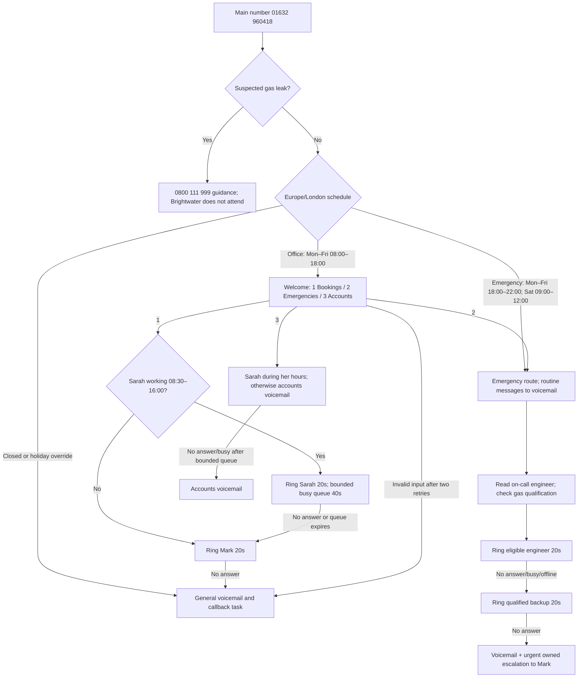

# Brightwater telephony handover

24 October 2026 · Fictional assessment · Proposed live configuration; implemented simulator

The simulator is usable now. The following live settings are proposals until Sarah, Mark and Meraki confirm them. Meraki's hosted platform is not identified in the assessment; the design does not assume that it is Twilio. No port, live number purchase or real call has been initiated.

## Call flow

The gas branch is modeled as a scenario flag. A live flow needs an approved prompt and key selection before normal routing; it cannot automatically diagnose the caller's emergency. No route promises attendance. Closed-hour and gas guidance must state the actual service limits.

## Proposed build sheet

| Person | Extension | Endpoint | Policy |
| --- | --- | --- | --- |
| Sarah Collins | 201 | Windows softphone + USB headset; optional supported desk phone | Bookings/accounts, weekdays 08:30–16:00 |
| Mark Ellis | 202 | Supported iPad/mobile app | Bookings fallback; owner escalation; Gas Safe |
| Dan Hughes | 203 | Supported personal-mobile work app | On-call rota; Gas Safe |
| Priya Shah | 204 | Supported personal-mobile work app | On-call rota; Gas Safe |
| Tom Barker | 205 | Supported personal-mobile work app | On-call plumbing only; gas jobs to qualified backup |
| Lewis Grant | 206 | Optional supervised app, license subject to approval | Apprentice; never emergency on-call |

Extensions are proposed, not existing facts. Confirm app/OS support, licenses, BYOD consent, battery permissions, mobile reception and headset needs. Do not assume the three existing BT cordless handsets support hosted SIP; inventory models first.

| Object | Proposed setting |
| --- | --- |
| Main number | Port 01632 960418 only after account ownership, service association and port eligibility checks |
| Secondary number | 01632 960419: do not cancel or port until its use, alarms/fax/dependencies and ownership are confirmed |
| Schedule | Europe/London with daylight-saving transitions; office and emergency windows as above |
| Holidays | Explicit approved dates; simulator closes the whole day; agree any live emergency exception separately |
| Welcome | Short brand welcome, then 1 bookings / 2 emergencies / 3 accounts |
| Invalid input | Two retries then general voicemail; verify provider timeout/retry semantics |
| Bookings group | Sarah, then Mark; Sarah omitted outside her working hours |
| Busy handling | Queue max 40 seconds; offer voicemail; expiry proceeds to fallback; confirm concurrency/licenses |
| Accounts | Sarah only during her hours; otherwise accounts voicemail |
| Emergency group | Current weekly primary, then qualified backup; no Lewis; Tom requires gas-qualified escalation |
| Ring timeout | 20 seconds per destination, configurable 10–60 seconds in demo |
| Answer confirmation | Live provider should require engineer acceptance so personal carrier voicemail cannot consume escalation |
| General voicemail | Proposed info@brightwaterplumbing.co.uk, owned callback queue |
| Accounts voicemail | Proposed accounts@brightwaterplumbing.co.uk |
| Emergency failure | Urgent follow-up owned by Mark, with confirmed independent notification and acknowledgment policy |
| Outbound identity | Verified/authorized main number via provider app or supported callback; native mobile calls retain mobile identity |
| Call recording | Off by default; voicemail only until purpose, access, notice and retention are agreed |
| Outage | Provider-hosted announcement/fallback independent of website, plus alternate connectivity and documented escalation |

Mailboxes are proposed destinations derived from the supplied address prefixes; confirm full domain, recipients, ownership and delivery controls. The software stores tasks but sends no email.

## Questions before live configuration

1. Which Meraki platform, license package and mobile apps will be used? This determines queue, failover, acceptance and caller-ID capabilities.
2. Who covers the 08:00–08:30 and 16:00–18:00 gaps, accounts absences, lunches and leave? Demo assumes Mark for bookings and voicemail for accounts.
3. Who is each week's backup, who publishes the rota, and how do both acknowledge handover? Confirm qualified cover when Tom is primary and what happens if the backup cannot attend.
4. Who receives urgent alerts, by which independent channel, and who acts when no acknowledgment arrives? Agree a realistic threshold before configuring it.
5. Are the 20-second rings and 40-second queue acceptable? Confirm simultaneous calls, waiting prompts and voicemail escape key.
6. What happens on bank holidays and planned closures? Demo's full-day closure is only a proposal.
7. Confirm both BT numbers, account holder, billing address, contract/port details and the second number's purpose. Broadband is on the main line and ends March 2027; porting may affect connectivity or fees.
8. Confirm mailbox addresses, access, retention, consent/notice and whether recordings or transcriptions are wanted. Never email sensitive recordings to an unconfirmed group.
9. Confirm handset models, engineer mobile OS/devices, reception, app permissions, Wi-Fi and mobile data; agree BYOD/work-hours arrangements.
10. Confirm the port window, temporary number, fallback contacts, provider rollback options and acceptance-test sign-off. Do not cancel BT before a coordinated migration.

## Draft email to Sarah — not sent

Hi Sarah,

The proposed system gives callers three choices: bookings, emergencies and accounts. Bookings reach you during your working hours, then Mark if you cannot answer. A short queue will help when you're already on a call. Accounts reach you or their own voicemail.

Emergency calls go to that week's engineer, then an agreed backup. If neither answers, Mark gets an urgent follow-up. Tom's gas-related jobs need a Gas Safe engineer. Outside the agreed service hours callers can leave a message, with clear guidance that emergency attendance is unavailable.

Engineers will use the phone-system app to call with the office number. Calling from the ordinary mobile dialer will still show their personal number.

Before setup, please confirm who covers your early/late hours and holidays; who approves and backs up the weekly rota; and who receives voicemail and urgent alerts. We'll also need the BT account details and the purpose of the old fax number. Because broadband shares the main line, we'll agree the migration with BT and our provider before moving anything.

We'll test the new system on a test number first and agree the transfer date with you.

Thanks

## Ticket #10482: investigation and response

Treat Saturday emergency failure as high priority and Mark's caller ID as a linked, separate work item. Neither is marked fixed without evidence. The simulator reproduces possible routes; it does not establish the actual cause.

1. Obtain the three call times, caller number securely, number dialed and timezone; confirm whether the customer still needs help through the client's established process. Do not promise an engineer or a same-day technical repair.
2. Match provider inbound logs and call IDs. Verify calls reached the expected number/tenant, not an old answerphone or redirect.
3. Inspect Saturday 09:00–12:00 schedule, timezone, holidays and the effective configuration version. A wrong schedule could send callers to voicemail before the rota is read.
4. Compare published rota, acknowledgment and audit history to Priya's intended assignment. Check whether routing used a stale group, wrong extension, missing backup or unacknowledged handover.
5. Inspect each ring leg: destination, offer time, response, timeout and final disposition. Distinguish an unoffered call from a device that never notified, and provider voicemail from personal carrier voicemail.
6. With Priya, check registration, app sign-in, push/notification permissions, Focus/DND, battery restrictions, network/data reception and app version. Check business hours/presence on the provider as well as the handset.
7. Inspect backup route, queue overflow, voicemail destination and alerts. Confirm Mark actually received and acknowledged the fallback task; an emailed voicemail alone is insufficient for an urgent route.
8. Reproduce on a test number with Priya and the backup: answered, declined, busy, offline, no-answer and carrier-voicemail cases. Record timestamps and call IDs. Change one cause at a time and retain the previous configuration.
9. For Mark separately, establish whether he used the provider app or native dialer. Check verified outbound CLI, permissions, number assignment and provider/carrier restrictions, then test to an external phone. Never suggest arbitrary spoofing.

Information needed: exact times and numbers; Priya's expected rota, device/OS/app, network and presence; Mark's calling method and example destination/time; relevant call IDs, effective configuration, recent changes and alert delivery evidence. Collect personal data through a secure support channel.

**Initial reply, within the hour — draft, not sent:**

Hi Sarah, I'm sorry those emergency calls did not reach Priya. I'm treating this as high priority and checking the Saturday call records, rota and Priya's app together. Please send the call times and the number the customer dialed through our secure support channel, and let us know whether the customer still needs assistance. I'll agree a temporary cover route with you while we investigate and update you within an hour, even if the cause is still being checked. I have also logged Mark's caller-ID issue separately so it is not lost behind the emergency fault. We will test both fixes with you before closing them.

**Prevention after diagnosis:** acknowledged primary/backup handover; Friday test call; qualified backup coverage; alerts for unregistered destinations and unanswered emergencies; owned follow-ups with acknowledgment; versioned configuration and rollback; scheduled test calls for Saturday/holiday/DST boundaries; app onboarding and BYOD guidance. Add tests for the actual root cause once known, rather than declaring every possible failure fixed.

## Optional future work: real test number (not part of this simulation release)

Implement a provider adapter behind the existing routing policy. Use a test number, signed webhook verification, idempotent event processing, explicit answer acceptance, status callbacks, persistent call-leg correlation and a job queue. Normalize timestamps to Europe/London at schedule evaluation. Store the published policy version on each call. Reject forged callbacks and handle retries/out-of-order events. Keep the emergency fallback independent from the web application. Exercise provider failure, device offline, personal voicemail, no answer, timeout, queue, qualification and holiday/DST cases before any port. Record the provider's actual behavior against the simulator; do not assume parity.
